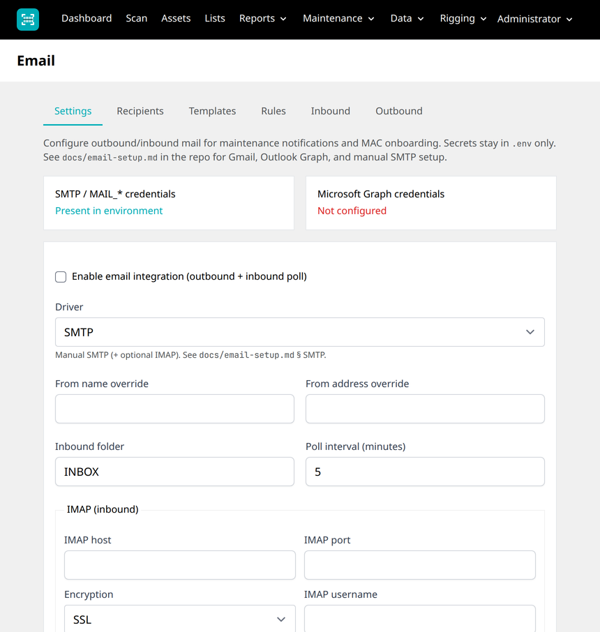
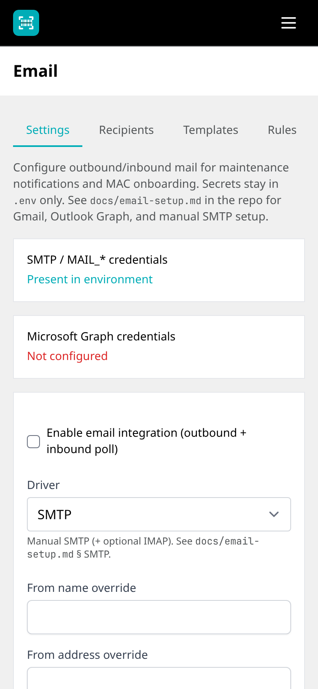

# Email integration setup

Optional developer feature that sends maintenance / MAC onboarding notifications and polls a mailbox for helpdesk replies. Replies that match an outbound thread are appended to the asset **Maintenance** log as Notes. Other inbound matches can be reviewed before apply.

The Maintenance tab itself is always available and does **not** require this feature flag.

## Contents

1. [Shared prerequisites](#1-shared-prerequisites)
2. [A. Gmail](#a-gmail)
3. [B. Outlook / Microsoft 365 (Graph)](#b-outlook--microsoft-365-graph)
4. [C. Manual SMTP](#c-manual-smtp)
5. [Recipients, templates, and MAC onboarding](#2-recipients-templates-and-mac-onboarding)
6. [Common notifications / Digests](#common-notifications--digests)
7. [Inbound polling and review](#3-inbound-polling-and-review)
8. [Troubleshooting](#4-troubleshooting)

---

## 1. Shared prerequisites

1. Enable **Email integration**. Administrators turn it on under Profile → Developer features. Other users need `features:email_integration` on their role, plus `email:ops` (inbound/outbound) or `admin:settings` (Email settings).
2. As admin, open **Email** (nav) → enable integration, choose driver (`gmail` | `outlook` | `smtp`), set from overrides / mailbox / poll interval.
3. Configure recipients and templates (seeded defaults exist after `php artisan db:seed` / `app:install`).
4. Set `APP_URL` to the public site URL (used in `{{asset.url}}` placeholders).
5. Align the from-address with the mailbox that is allowed to send (SPF/DKIM on your DNS — follow your provider’s guide).
6. **Secrets only in `.env`**. Never paste passwords or client secrets into the admin UI.
7. Scheduler (inbound poll + digests):

```bash
* * * * * cd /var/www/av-asset-manager && php artisan schedule:run >> /dev/null 2>&1
```

Poll cadence is controlled by **Poll interval (minutes)** in Admin → Email. The command is `email:poll-inbound`. When email integration is enabled, the scheduler also runs `email:send-digests` **daily** (see [Common notifications / Digests](#common-notifications--digests)).

8. Queue (optional but recommended if you later queue mailables):

```bash
php artisan queue:work
```

9. After configuring credentials, use **Send test email** on the Email settings page.

**Admin → Email** (Settings tab)

| Desktop | Mobile |
|---------|--------|
|  |  |

### Feature flag behaviour

| Surface | Flag off | Flag on + mail disabled | Flag on + mail enabled |
|--------|----------|-------------------------|------------------------|
| Maintenance tab | Available | Available | Available |
| Admin email / recipients / templates / rules / inbound | 404 | Available | Available |
| MAC onboarding checkbox on asset create | Hidden | Hidden (mail off) | Shown when a MAC value is present |
| Outbound dispatch | No | No | Yes |

---

## A. Gmail

### Account

1. Enable 2-Step Verification on the Google Account (or Workspace user).
2. Create an **App Password** (Google Account → Security → App passwords).
3. Workspace admins: ensure SMTP is allowed for the org; “Less secure apps” is not used — app passwords replace that flow.

### `.env` example

```env
MAIL_MAILER=smtp
MAIL_HOST=smtp.gmail.com
MAIL_PORT=587
MAIL_SCHEME=null
MAIL_USERNAME=you@example.com
MAIL_PASSWORD=xxxx-xxxx-xxxx-xxxx
MAIL_FROM_ADDRESS="you@example.com"
MAIL_FROM_NAME="${APP_NAME}"
```

Use the same address for `MAIL_USERNAME` and `MAIL_FROM_ADDRESS`. The password is the **app password**, not the Google account password.

### Admin UI

1. Driver: **Gmail**
2. Inbound IMAP presets are applied in code: `imap.gmail.com`, port `993`, SSL.
3. Set IMAP username if different from `MAIL_USERNAME` (usually the full Gmail address).
4. IMAP password is always `MAIL_PASSWORD` from `.env`.

### Limits and common errors

- Gmail enforces daily sending quotas; burst traffic may be deferred.
- `Username and Password not accepted` → wrong app password, 2FA missing, or SMTP blocked by Workspace policy.
- “Less secure apps” messages are outdated for app-password setups — create a new app password instead.

---

## B. Outlook / Microsoft 365 (Graph)

### Entra app registration

1. Register an app (dedicated mail app recommended; can be separate from SSO).
2. Application (client) permissions:
   - `Mail.Send`
   - `Mail.Read` (or least privilege for the shared mailbox you use)
3. Grant **admin consent**.
4. Create a client secret; note tenant ID, client ID, secret.

SSO login uses `openid` / `profile` / `email` delegated scopes. Mail needs **application** Graph permissions — keep Graph keys separate from `AZURE_*` SSO credentials.

### `.env` example

```env
MICROSOFT_GRAPH_CLIENT_ID=
MICROSOFT_GRAPH_CLIENT_SECRET=
MICROSOFT_GRAPH_TENANT_ID=

# Optional from-address for display; Graph send uses the mailbox UPN below
MAIL_FROM_ADDRESS="noreply@example.com"
MAIL_FROM_NAME="${APP_NAME}"
```

### Admin UI

1. Driver: **Outlook**
2. **Outlook mailbox UPN** — user or shared mailbox that the app can send/read as
3. **Inbound folder** — usually `Inbox`

### Graph endpoints used

- Token: `https://login.microsoftonline.com/{tenant}/oauth2/v2.0/token` (client credentials)
- Send: `POST /users/{mailbox}/sendMail`
- Poll: `GET /users/{mailbox}/mailFolders/{folder}/messages?$filter=isRead eq false`

### Common errors

- `401` / `403` → missing consent, wrong tenant, or mailbox not in tenant
- Throttling → reduce poll frequency; back off and retry
- Wrong mailbox UPN → Graph cannot resolve the user

---

## C. Manual SMTP

Use for on-prem relays, SendGrid/Mailgun SMTP, cPanel, Amazon SES SMTP, etc.

### `.env` matrix

| Variable | Typical values |
|----------|----------------|
| `MAIL_MAILER` | `smtp` |
| `MAIL_HOST` | Provider hostname |
| `MAIL_PORT` | `587` (STARTTLS), `465` (SMTPS), or `25` (relay) |
| `MAIL_SCHEME` / encryption | Follow Laravel mail config for your version (`tls` / `ssl` / null) |
| `MAIL_USERNAME` / `MAIL_PASSWORD` | Provider credentials (optional for open relay) |
| `MAIL_FROM_ADDRESS` | Address aligned with SPF/DKIM |

EHLO/domain alignment and DNS (SPF/DKIM/DMARC) are provider-specific — use their documentation rather than duplicating vendor DNS guides here.

### Admin UI

1. Driver: **SMTP**
2. Configure IMAP host/port/encryption/username for inbound (password = `MAIL_PASSWORD`)
3. Ubuntu firewall: allow outbound TCP `587`/`465` as required

### Test plan

1. Admin → Email → **Send test email** → confirm receipt
2. Optional: reply to a MAC onboarding message → after poll, Note appears on the asset Maintenance tab

---

## 2. Recipients, templates, and MAC onboarding

1. **Recipients** — add IT helpdesk (and others). Role tag `it_helpdesk` is conventional.
2. **Templates** — one active template per event key. Select dynamic fields (core + `custom.{slug}` from item-type field sets) and bind recipients with required fields.
3. **MAC onboarding** (`asset_mac_onboarding`):
   - On asset **create**, when the feature is on and mail is enabled, a checkbox appears once a MAC value is present (core `mac_address` or MAC-named custom fields).
   - Successful send stores an outbound thread (for reply matching) and appends a short Maintenance Note.
   - Create-only in v1 (not on edit).

Other event keys: `maintenance_log_created`, `maintenance_fault_status_changed`, `inbound_match_pending`, `inbound_match_applied`, `inbound_match_rejected`, plus digest keys `warranty_expiry_digest`, `test_tag_expiry_digest`, `low_stock_digest`.

Inbound Notes with `source=email` do **not** re-trigger outbound notifications (loop guard).

---

## Common notifications / Digests

On **Admin → Email → Settings**, the **Common notifications / Digests** block appears only when digests are available: email integration is **enabled** and the chosen driver has credentials configured (`EmailIntegrationSettings::digestsAvailable()` — SMTP/Gmail need mail credentials; Outlook needs Graph client id/secret/tenant).

When available, admins can toggle:

| Digest | What it covers |
|--------|----------------|
| **Warranty expiry** | Assets whose `warranty_expiry` falls within **Days ahead** |
| **Test & Tag expiry** | Assets whose `test_tag_expiry` falls within **Days ahead** |
| **Low stock** | Assets with Stock levels at or below their minimum (asset Stock module) |

Configure matching **templates** and **recipients** under Email → Templates (event keys above). Digests do not send unless the toggle is on, templates/recipients are set, and the scheduler is running.

```bash
php artisan email:send-digests   # also scheduled daily via schedule:run when integration is enabled
```

---

## 3. Inbound polling and review

1. Scheduler runs `email:poll-inbound` according to the poll interval.
2. **Thread replies** (In-Reply-To / References / Graph conversation id matching `outbound_email_threads`) → auto-append Note to the asset Maintenance log (`auto_applied`).
3. **Other rules** → pending row in **Inbound email**; admin or inventory manager applies or rejects.
4. Deduplication key: `source_message_id` (idempotent).

Asset resolution fallbacks for non-thread mail: exact match on `fmi_ast`, `tp_barcode`, `rig_tag`, `serial_number`, `mac_address`.

---

## 4. Troubleshooting

| Symptom | Checks |
|---------|--------|
| Email admin links missing / 404 | Enable **Email integration** (admin profile, or the role for anyone else) and the matching permission (`admin:settings` or `email:ops`) |
| Digests section missing | Integration enabled **and** credentials present for the driver (mail `.env` or Graph keys) |
| Digests not arriving | Toggle on; template + recipients for the digest event key; cron running `schedule:run`; check `email:send-digests` |
| Checkbox missing on create | Feature on, mail enabled in Admin → Email, and a MAC value typed |
| Send skipped with warning | Recipient required fields empty (name and at least one MAC) |
| Auth failures (SMTP) | App password, username=full email, port/encryption |
| Graph 401/403 | Admin consent, tenant, mailbox UPN, app permissions |
| Replies not logging | Scheduler/cron, poll interval, thread Message-ID preserved by helpdesk |
| Duplicate processing | Already handled via unique `source_message_id` |
| TLS / firewall | Outbound 587/465; IMAP 993 |
| Spam/junk | From-domain SPF/DKIM; warm up new senders |

Maintenance history for devices remains on the asset **Maintenance** tab regardless of email flag state.
