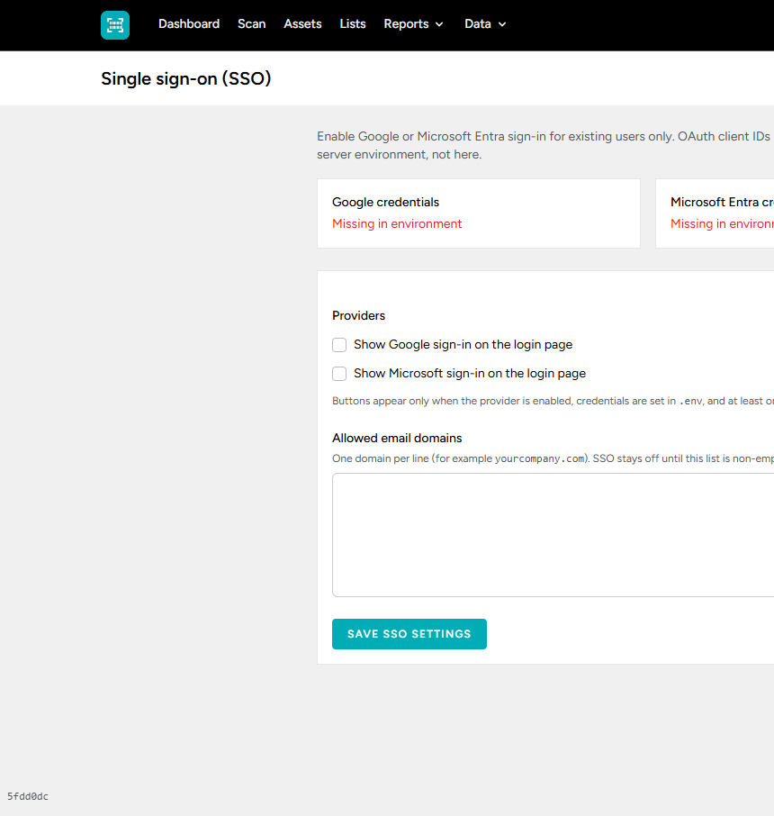
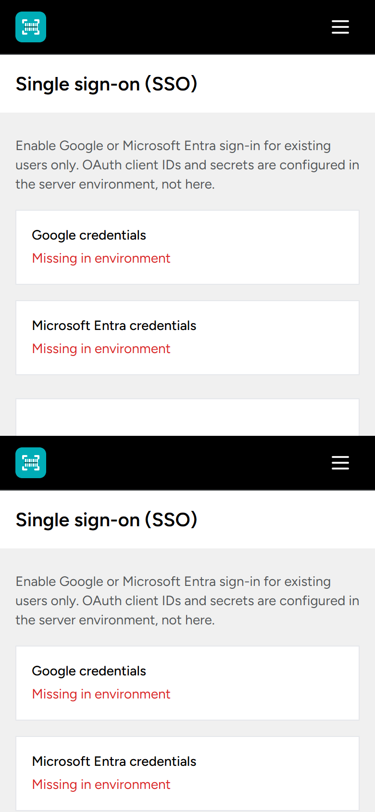

# Single sign-on (Google & Microsoft Entra)

Optional OAuth sign-in for **existing** users only. The app does not create accounts from the identity provider (IdP). Email and password login stays available.

Supported providers:

| Provider | Login button | IdP console |
|----------|--------------|-------------|
| Google | Continue with Google | Google Cloud OAuth |
| Microsoft | Continue with Microsoft | Microsoft Entra ID (work/school accounts) |

Credentials live in `.env` only. Provider toggles and the **allowed email domain** list are stored in the app database and managed under **Admin → SSO**.

**Admin → SSO**

| Desktop | Mobile |
|---------|--------|
|  |  |

## How visibility works

A provider button appears on the login page only when **all** of the following are true:

1. An admin enabled the provider under **Admin → SSO**.
2. The matching `.env` variables are set (see below).
3. At least one allowed email domain is configured (SSO is off while the domain list is empty).

OAuth redirect and callback routes are rate-limited (`10` requests per minute per IP).

## Redirect URIs

`APP_URL` must match the URL users use in the browser (scheme, host, and port). Register these exact callback URLs in each IdP:

| Provider | Callback path | Example |
|----------|---------------|---------|
| Google | `{APP_URL}/auth/google/callback` | `https://assets.example.com/auth/google/callback` |
| Microsoft Entra | `{APP_URL}/auth/azure/callback` | `https://assets.example.com/auth/azure/callback` |

Application routes (for reference):

- `GET /auth/{provider}/redirect` — starts OAuth (`google` or `azure`)
- `GET /auth/{provider}/callback` — handles the IdP response

## Environment variables

Copy from `.env.example` and fill in values from each provider console. Never commit secrets.

```env
GOOGLE_CLIENT_ID=
GOOGLE_CLIENT_SECRET=
GOOGLE_REDIRECT_URI="${APP_URL}/auth/google/callback"

AZURE_CLIENT_ID=
AZURE_CLIENT_SECRET=
AZURE_REDIRECT_URI="${APP_URL}/auth/azure/callback"
AZURE_TENANT_ID=
```

| Variable | Provider | Notes |
|----------|----------|--------|
| `GOOGLE_CLIENT_ID` | Google | OAuth 2.0 Client ID (Web application) |
| `GOOGLE_CLIENT_SECRET` | Google | Client secret |
| `GOOGLE_REDIRECT_URI` | Google | Must match an **Authorized redirect URI** in Google Cloud |
| `AZURE_CLIENT_ID` | Entra | Application (client) ID |
| `AZURE_CLIENT_SECRET` | Entra | Client secret value (not the secret ID) |
| `AZURE_REDIRECT_URI` | Entra | Must match a **Web** redirect URI in Entra |
| `AZURE_TENANT_ID` | Entra | Directory (tenant) ID for a **single-tenant** app — do **not** use `common` or `organizations` |

After changing `.env` on a server with config caching:

```bash
php artisan config:clear
# or, in production after verifying values:
php artisan config:cache
```

**Admin → SSO** shows whether Google and Entra credentials are detected in the environment.

---

## Google Cloud OAuth setup

Use a Google Cloud project owned by your organisation. These steps assume Google Workspace or Cloud Identity users in your domain; consumer `@gmail.com` accounts are only useful if you explicitly allow that domain in the app whitelist.

### 1. Create or select a project

1. Open [Google Cloud Console](https://console.cloud.google.com/).
2. Create a project (or select an existing one) for this application.

### 2. Configure the OAuth consent screen

1. **APIs & Services → OAuth consent screen**.
2. Choose **Internal** if the app is only for users in your Google Workspace organisation; otherwise **External** (you may need verification for broad external use).
3. Fill in app name, support email, and developer contact.
4. **Scopes:** the application uses standard OpenID scopes via Laravel Socialite (`openid`, `profile`, `email`). You do not need custom Google API scopes for login.
5. Save. If External, add test users while in testing mode.

### 3. Create OAuth client credentials

1. **APIs & Services → Credentials → Create credentials → OAuth client ID**.
2. Application type: **Web application**.
3. **Authorized redirect URIs:** add `{APP_URL}/auth/google/callback` (production and, if needed, a separate client or URI for local dev such as `http://127.0.0.1:8000/auth/google/callback`).
4. Create and copy the **Client ID** and **Client secret** into `GOOGLE_CLIENT_ID` and `GOOGLE_CLIENT_SECRET`.

### 4. Workspace and domain behaviour

- The app checks that the signed-in email’s domain is in **Admin → SSO → Allowed email domains** (suffix match on `@domain`).
- For Google, the IdP must return a **verified** email (`email_verified` must be true).
- If exactly **one** domain is in the whitelist, the app adds Google’s `hd` (hosted domain) hint on redirect to encourage accounts from that Workspace domain. This is a hint only; the whitelist and verified-email checks still apply.
- Restricting the OAuth client to your organisation in Google Cloud (Internal consent + Workspace) aligns with a corporate domain whitelist but does not replace the in-app domain list.

---

## Microsoft Entra ID setup (business / work accounts)

Use an app registration in the **same tenant** as your users. Personal Microsoft accounts are not the target audience; use **single tenant** and your organisation’s `AZURE_TENANT_ID`.

### 1. Register an application

1. [Microsoft Entra admin center](https://entra.microsoft.com/) → **Identity → Applications → App registrations → New registration**.
2. Name: e.g. `AV Asset Manager`.
3. **Supported account types:** **Accounts in this organizational directory only (Single tenant)**.
4. Redirect URI: platform **Web**, URI `{APP_URL}/auth/azure/callback`.
5. Register. Note the **Application (client) ID** and **Directory (tenant) ID**.

### 2. Client secret

1. **Certificates & secrets → New client secret**.
2. Copy the **Value** immediately into `AZURE_CLIENT_SECRET` (it is shown only once).

### 3. Authentication

1. **Authentication** → confirm the **Web** redirect URI matches `AZURE_REDIRECT_URI`.
2. If offered, enable **ID tokens** for implicit/hybrid flows is **not** required; the app uses the authorization code flow via Socialite.

### 4. API permissions (delegated)

Under **API permissions**, ensure Microsoft Graph **delegated** permissions allow sign-in and email:

| Permission | Purpose |
|------------|---------|
| `openid` | OpenID Connect sign-in |
| `profile` | Name claims |
| `email` | Email claim |
| `User.Read` | Default Graph read for signed-in user (commonly added with Microsoft login) |

Click **Grant admin consent** for your tenant if prompted.

The app uses `socialiteproviders/microsoft-azure` with `AZURE_TENANT_ID` driving the authority URL (single tenant).

### 5. Map to `.env`

```env
AZURE_CLIENT_ID=<Application (client) ID>
AZURE_CLIENT_SECRET=<client secret value>
AZURE_TENANT_ID=<Directory (tenant) ID>
AZURE_REDIRECT_URI="${APP_URL}/auth/azure/callback"
```

Do not set `AZURE_TENANT_ID` to `common`; multi-tenant “any org” sign-in is not supported by this configuration.

---

## Application setup

### 1. Install and migrate

On a new server, follow [deploy-ubuntu-nginx.md](deploy-ubuntu-nginx.md) through `php artisan app:install` and `php artisan migrate` on upgrades. SSO uses the `settings` table (key `sso`); no separate SSO migration step.

### 2. Configure `.env`

Set `APP_URL` and the provider variables above. Reload PHP-FPM or clear config cache after changes.

### 3. Configure **Admin → SSO**

Sign in as an **admin** → **SSO** in the navigation.

1. Enter **Allowed email domains** — one domain per line, without `@` (e.g. `yourcompany.com`). SSO remains disabled until this list is non-empty.
2. Enable **Show Google sign-in** and/or **Show Microsoft sign-in** as needed.
3. Save. The page reports whether each provider’s credentials are present in the environment.

### 4. Create users before SSO

For each person who will use SSO:

1. **Admin → Users** — create a user whose **email** exactly matches what their IdP will return (comparison is case-insensitive).
2. Assign roles as usual.

SSO does **not** register new users. If the IdP email is not in the database, login fails with a message to contact an administrator.

On first successful SSO login, if the user record had no `email_verified_at`, the app sets it automatically.

### 5. Verify

1. Open the login page in a private/incognito window.
2. Confirm the expected **Continue with …** buttons appear.
3. Sign in with an IdP account whose email matches an existing user and an allowed domain.
4. Confirm you reach the dashboard.
5. Confirm password login still works for the same user.

---

## Troubleshooting

| Symptom | Likely cause | What to check |
|---------|----------------|---------------|
| No SSO buttons on login | Provider disabled, missing `.env`, or empty domain list | **Admin → SSO** toggles, credential status cards, allowed domains |
| Redirect to Google/Microsoft then generic error | Wrong redirect URI, bad secret, or tenant mismatch | IdP redirect URI **character-for-character** match with `APP_URL`; `AZURE_TENANT_ID` is your directory ID |
| `redirect_uri_mismatch` (Google) | URI not registered | Google Cloud → Credentials → your Web client |
| AADSTS50011 or redirect errors (Microsoft) | Redirect URI not registered or wrong tenant | Entra → Authentication → Web redirect URIs; single-tenant app |
| “Your email domain is not allowed…” | Email not in whitelist | Add the domain part after `@` in **Allowed email domains** |
| “No account exists for this email…” | Link-only SSO | Create user with that email in **Admin → Users** |
| “Your email address must be verified…” (Google) | Unverified Google email | Use a verified Workspace account |
| “Your sign-in provider did not return an email address” | Missing email scope/claim | Google consent/scopes; Entra `email` + admin consent |
| SSO works locally but not in production | `APP_URL` or cached config | `APP_URL=https://…` matches public URL; `php artisan config:cache` after `.env` update |
| Buttons show but redirect denied immediately | Provider not “visible” (disabled mid-flow) or throttle | Re-save **Admin → SSO**; wait if rate-limited |

Check Laravel logs (`storage/logs/laravel.log`) for OAuth exceptions. Do not log or paste client secrets in tickets.

---

## Security notes

- Keep client secrets in `.env` or your secrets manager only.
- Use HTTPS in production so authorization codes and session cookies are not exposed.
- The domain whitelist limits which email addresses may complete SSO even if someone obtains OAuth client credentials.
- SharePoint / Graph **application** permissions (`GRAPH_*` in `.env`) are for file storage and backups only; they are separate from interactive SSO and use different Entra app registrations if you split concerns.

## Related documentation

- [deploy-ubuntu-nginx.md](deploy-ubuntu-nginx.md) — server install and brief SSO pointer
- [.env.example](../.env.example) — variable names
